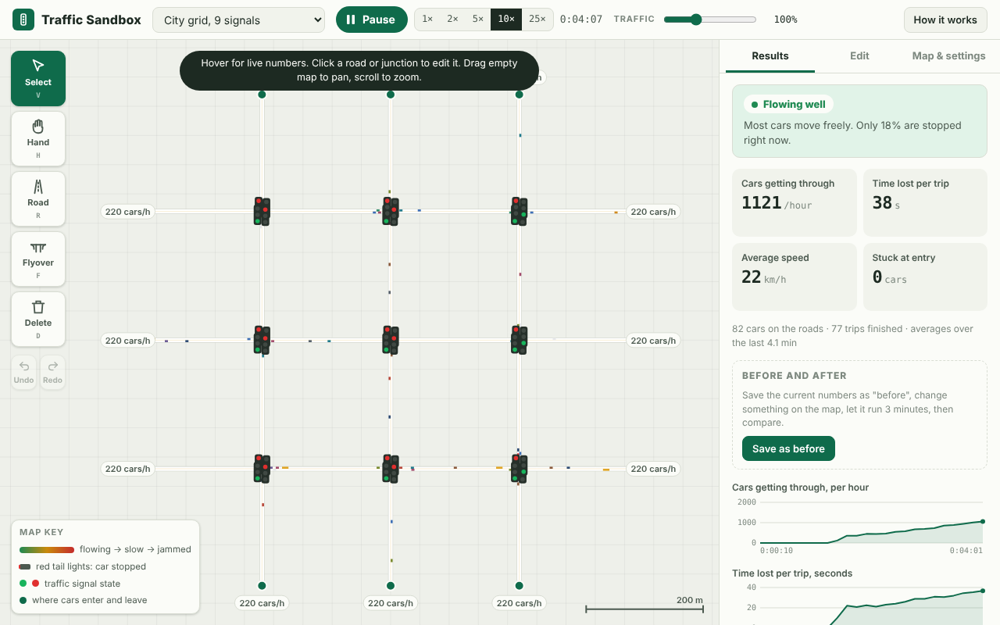

# Traffic Sandbox

A traffic simulator that runs in your browser. Draw roads, time the signals, ban turns, add a flyover, or import a real neighbourhood from OpenStreetMap. Then watch whether the jams actually get better.

**Live:** https://vishwadeep-solves-conflicts.github.io/traffic-sandbox/



## What you can do

- **Start from a preset** (city grid, main road with side streets, a single or overloaded crossroads, a lane-drop bottleneck) or a blank canvas.
- **Edit the network:** draw roads with 1–3 lanes each way or one-way, set speed limits, delete, undo and redo.
- **Tune junctions:** green time per direction, which turns are allowed, how many cars enter at each edge.
- **Build flyovers** that carry a road over a junction.
- **Compare before and after:** save the current numbers, change something, let it run, and see the difference in throughput, time lost per trip, average speed and queues.
- **Use a real map:** run the provided query on [overpass-turbo.eu](https://overpass-turbo.eu/), paste or upload the result, and the roads become a network you can simulate.
- **Save and share** a network as text, and run at 1× to 25× speed.

## How it works

It's a React app built with Vite. React lays out the page; the simulation itself is plain JavaScript with no other dependencies.

- **Cars:** each one is simulated individually, using the [Intelligent Driver Model](https://en.wikipedia.org/wiki/Intelligent_driver_model) for following, braking and queuing. About 7% are trucks.
- **Routes:** every car heads for a destination and takes the shortest route to it. Smart routing also avoids lanes that are already full.
- **Junctions:** each can be a fixed-time signal, a smart signal that reacts to queues, an all-way stop, give-way to the main road, or uncontrolled.
- **Signal timing:** a built-in optimiser re-times the signals from the flows it has measured, using a saturation flow of 1,600 cars per hour per lane.

The panel on the right turns all of this into live numbers and charts over a rolling 5-minute window. Nothing is saved on a server: to keep a network, copy it as text.

## Run it locally

You need Node 20 or newer.

```bash
git clone https://github.com/vishwadeep-solves-conflicts/traffic-sandbox
cd traffic-sandbox
npm install
npm run dev      # http://localhost:5173
npm run build    # production build in dist/
```

## Where things are

```
src/
  engine/              the simulation, no DOM
    model.js           junctions and roads, and edits like flyovers and service roads
    network.js         lanes, signal phases and priority built from the model
    routing.js         shortest routes to every exit
    vehicles.js        cars and trucks, the Intelligent Driver Model, lane choice
    control.js         signals, stops and give-way rules
    connectors.js      paths through junctions
    simulation.js      one time step, metrics, the signal optimiser
    presets.js         the example networks
    importExport.js    save/load as text, OpenStreetMap import
    history.js         undo and redo
    state.js           shared changing state (network, cars, clock)
    constants.js       lane width, time step, road types
  map/                 the canvas: camera, mouse and keyboard, drawing, colours
  panels/              the side panel: results, inspector, charts, tooltip, guide
  components/          React markup for the page (top bar, tools, panels)
  styles/
    theme.css          map and panel colours for each theme
    app.css            layout
  shared/              theme switcher and top bar, the same in every app
  startEngine.js       starts everything and runs the frame loop
```

React renders the page once. `startEngine()` then wires the controls by their `id`s, and the engine updates the canvas and panels directly every frame, which keeps the simulation fast. To try things from the browser console, use `window.sim` (for example `sim.loadPreset('busy')` or `sim.currentMetrics()`).

## Deploying

Every push to `main` runs `.github/workflows/deploy.yml`, which builds the app and publishes `dist/` to the `gh-pages` branch. GitHub Pages serves that branch, and the self-hosted server copies it.

## Map data

Maps you import come from OpenStreetMap. Map data © [OpenStreetMap contributors](https://www.openstreetmap.org/copyright), available under the Open Database License. The repo itself ships no map data: the presets are drawn by hand.

## Licence

MIT. Built by [Vishwadeep Kushwaha](https://vishwadeep-s.netlify.app).
